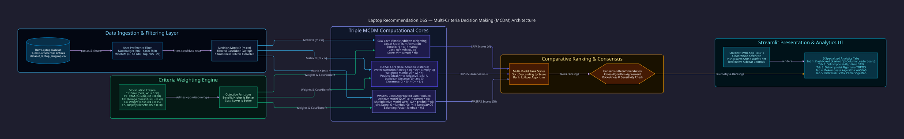

<div align="center">
  <br />
  <h1 align="center">💻 Laptop Recommendation DSS</h1>
  <p align="center"><i>MULTI-CRITERIA DECISION SUPPORT SYSTEM · SAW · TOPSIS · WASPAS ENGINES</i></p>

  <a href="https://laptop-recommendation-dss.streamlit.app/" target="_blank">
    
  </a>
  <br />

  <p align="center">
    <a href="https://laptop-recommendation-dss.streamlit.app/" target="_blank">
      
    </a>
  </p>

  <p align="center">
    
    
    
    
    
    
    
    
  </p>

  <p align="center" style="max-width: 850px; font-size: 1.05rem; color: #94a3b8; line-height: 1.6;">
    <b>Laptop Recommendation DSS</b> adalah platform Sistem Pendukung Keputusan (<i>Decision Support System / DSS</i>) berbasis riset operasi dan sains data terapan yang mengeliminasi bias pemasaran dalam pemilihan komputer jinjing komersial. Mengintegrasikan <b>3 algoritma Multi-Criteria Decision Making (MCDM)</b> klasik sekaligus—<b>SAW (Simple Additive Weighting)</b>, <b>TOPSIS (Technique for Order Preference by Similarity to Ideal Solution)</b>, dan <b>WASPAS (Weighted Aggregated Sum Product Assessment)</b>—sistem ini mengevaluasi 1.304 data laptop secara matematis berdasarkan 5 kriteria spesifikasi kuantitatif, disajikan dalam antarmuka analitik interaktif <b>Streamlit</b> dengan dekomposisi matriks transparan.
  </p>
</div>

<p align="center"></p>

## 🏛️ Arsitektur Sistem Komputasi MCDM

Sistem memproses data melalui pipeline deterministik berlapis: mulai dari parsing dataset mentah, penyaringan batasan pengguna, pembentukan matriks keputusan $X$, kalkulasi paralel 3 engine MCDM, hingga agregasi pemeringkatan konsensus pada UI Streamlit:

<p align="center">
  
</p>

<p align="center"></p>

## ⚡ Fitur Rekayasa Unggulan

<table align="center" width="100%">
  <tr>
    <td width="50%" valign="top">
      <b>🎯 Dynamic Budgeting & Spec Filtering</b><br/>
      Menyaring 1.304 data laptop komersial secara <i>real-time</i> berdasarkan batasan anggaran maksimum (200 – 6.000 EUR), kapasitas RAM minimum (4 – 64 GB), serta populasi alternatif evaluasi (5 – 20 kandidat) untuk membentuk matriks keputusan $X_{m \times n}$ yang relevan dengan preferensi pengguna.
    </td>
    <td width="50%" valign="top">
      <b>🧮 Triple MCDM Algorithmic Engines</b><br/>
      Mengeksekusi tiga paradigma optimasi multi-kriteria secara simultan: <b>SAW</b> (skala aditif linear), <b>TOPSIS</b> (jarak geometris Euclidean ke solusi ideal positif dan negatif), dan <b>WASPAS</b> (hibrida WSM aditif dan WPM multiplikatif eksponensial dengan $\lambda = 0.5$).
    </td>
  </tr>
  <tr>
    <td width="50%" valign="top">
      <b>🔍 Dekomposisi Perhitungan Matematis Transparan</b><br/>
      Setiap tahapan aljabar linier dibuka secara eksplisit pada tab terpisah: Matriks Normalisasi $R$, Matriks Terbobot $Y$, Titik Solusi Ideal $A^+ / A^-$, Jarak Geometris $D^+ / D^-$, hingga Skor Agregasi Akhir. Menjamin prinsip <i>Explainable AI / Auditable DSS</i> tanpa kotak hitam (*black-box*).
    </td>
    <td width="50%" valign="top">
      <b>📊 Analisis Konsensus & Validasi Silang</b><br/>
      Membandingkan peringkat antar-metode secara berdampingan (*3-column leaderboard*). Pengguna dapat mendeteksi kandidat laptop yang stabil menempati peringkat teratas di ketiga metode sekaligus, meminimalkan anomali hasil akibat karakteristik khusus salah satu formula.
    </td>
  </tr>
  <tr>
    <td width="50%" valign="top">
      <b>📈 Visualisasi Distribusi Peringkat Horisontal</b><br/>
      Tab visualisasi menyajikan grafik batang horisontal komparatif (Matplotlib) untuk ketiga metode dengan gradien monokrom slate elegan. Nilai skor preferensi setiap alternatif diplot secara presisi hingga 4 digit desimal untuk membedakan margin skor yang tipis.
    </td>
    <td width="50%" valign="top">
      <b>🌐 Zero-Cloud Telemetry & Deployment Mandiri</b><br/>
      Aplikasi beroperasi secara lokal tanpa ketergantungan API pihak ketiga atau transmisi data ke cloud eksternal. Seluruh dataset dan logika komputasi berjalan di memori lokal klien, didukung berkas requirements terisolasi dan skema lisensi open-source MIT.
    </td>
  </tr>
</table>

<p align="center"></p>

## 🧮 Matriks Perbandingan Formula Matematis MCDM

Ketiga algoritma mengevaluasi matriks keputusan dasar $X = [x_{ij}]_{m \times n}$ di mana $m$ adalah jumlah laptop kandidat dan $n = 5$ adalah jumlah kriteria:

| Komponen Evaluasi | Simple Additive Weighting (SAW) | TOPSIS (Similarity to Ideal Solution) | WASPAS (Aggregated Sum-Product) |
|---|---|---|---|
| **Metode Normalisasi ($r_{ij}$)** | Transformasi Skala Linear:<br/>• Benefit: $r_{ij} = \frac{x_{ij}}{\max_k x_{kj}}$<br/>• Cost: $r_{ij} = \frac{\min_k x_{kj}}{x_{ij}}$ | Normalisasi Vektor Euclidean:<br/>$r_{ij} = \frac{x_{ij}}{\sqrt{\sum_{k=1}^m x_{kj}^2}}$ | Transformasi Skala Linear SAW:<br/>• Benefit: $r_{ij} = \frac{x_{ij}}{\max_k x_{kj}}$<br/>• Cost: $r_{ij} = \frac{\min_k x_{kj}}{x_{ij}}$ |
| **Pembobotan Matriks** | Dikalikan langsung saat penjumlahan akhir | Matriks Terbobot:<br/>$y_{ij} = w_j \cdot r_{ij}$ | Diterapkan terpisah pada model WSM dan WPM |
| **Model Preferensi** | **Penjumlahan Terbobot Linear (WSM):**<br/>$V_i = \sum_{j=1}^n w_j \cdot r_{ij}$ | **Kedekatan Relatif Geometris:**<br/>$C_i = \frac{D_i^-}{D_i^+ + D_i^-}$ | **Kombinasi Hibrida Aditif-Multiplikatif:**<br/>$Q_i = \lambda Q_i^{(1)} + (1 - \lambda) Q_i^{(2)}$ |
| **Titik Acuan Ekstrem** | Nilai lokal $\max$ dan $\min$ per kolom | • $A_j^+ = \max y_{ij}$ (benefit) / $\min y_{ij}$ (cost)<br/>• $A_j^- = \min y_{ij}$ (benefit) / $\max y_{ij}$ (cost) | Nilai lokal $\max$ dan $\min$ per kolom |
| **Jarak Geometris** | Tidak menggunakan metrik jarak | • $D_i^+ = \sqrt{\sum_{j=1}^n (y_{ij} - A_j^+)^2}$<br/>• $D_i^- = \sqrt{\sum_{j=1}^n (y_{ij} - A_j^-)^2}$ | Tidak menggunakan metrik jarak |
| **Komponen Pendukung** | — | — | • WSM: $Q_i^{(1)} = \sum_{j=1}^n w_j r_{ij}$<br/>• WPM: $Q_i^{(2)} = \prod_{j=1}^n (r_{ij})^{w_j}$<br/>• Parameter $\lambda = 0.5$ |
| **Kompleksitas Waktu** | $\mathcal{O}(m \cdot n)$ | $\mathcal{O}(m \cdot n)$ | $\mathcal{O}(m \cdot n)$ |
| **Karakteristik Utama** | Intuitif, cepat, sensitif terhadap skala linear | Kuat terhadap alternatif kompromi ekstrem | Menyeimbangkan trade-off penjumlahan dan perkalian eksponensial |

<p align="center"></p>

## 📋 Definisi Kriteria & Pembobotan Sistem

Sistem mengadopsi 5 parameter teknis laptop dengan total bobot ternormalisasi $\sum_{j=1}^5 w_j = 1.00$:

| Kode | Kriteria Evaluasi | Tipe Atribut | Bobot ($w_j$) | Satuan | Deskripsi Operasional |
|:---:|---|:---:|:---:|:---:|---|
| **$C_1$** | **Harga (Price)** | **Cost** | **0.35 (35%)** | Euros (€) | Nilai yang semakin rendah diprioritaskan untuk efisiensi anggaran. |
| **$C_2$** | **Kapasitas RAM** | **Benefit** | **0.20 (20%)** | GB | Kapasitas memori kerja yang semakin besar diprioritaskan untuk multitasking. |
| **$C_3$** | **Kapasitas Storage** | **Benefit** | **0.20 (20%)** | GB | Total ruang penyimpanan SSD/HDD internal (TB dikonversi ke ribuan GB). |
| **$C_4$** | **Bobot (Weight)** | **Cost** | **0.15 (15%)** | Kilogram (kg) | Berat perangkat fisik; semakin ringan semakin portabel untuk mobilitas kerja. |
| **$C_5$** | **Ukuran Layar** | **Benefit** | **0.10 (10%)** | Inci (") | Dimensi diagonal layar visual untuk kenyamanan produktivitas kerja. |

$$\text{Fungsi Kriteria Cost: } r_{ij} = \frac{\min_k x_{kj}}{x_{ij}} \quad \Big| \quad \text{Fungsi Kriteria Benefit: } r_{ij} = \frac{x_{ij}}{\max_k x_{kj}}$$

<p align="center"></p>

## 🔬 Simulasi Numerik & Verifikasi Deterministik

Untuk menguji integritas komputasi, perhatikan contoh simulasi numerik 3 laptop kandidat berikut:

### 1. Matriks Keputusan Awal ($X$)
| Alternatif | Harga ($C_1$, Cost) | RAM ($C_2$, Benefit) | Storage ($C_3$, Benefit) | Berat ($C_4$, Cost) | Layar ($C_5$, Benefit) |
|---|:---:|:---:|:---:|:---:|:---:|
| **Laptop A** | € 500 | 8 GB | 256 GB | 1.8 kg | 14.0" |
| **Laptop B** | € 800 | 16 GB | 512 GB | 1.5 kg | 15.6" |
| **Laptop C** | € 1.200 | 16 GB | 1.000 GB | 2.1 kg | 15.6" |
| **Nilai Ekstrem** | $\min = 500$ | $\max = 16$ | $\max = 1000$ | $\min = 1.5$ | $\max = 15.6$ |

### 2. Normalisasi Matriks SAW ($R$) & Skor Preferensi ($V$)
- $r_{A1} = \frac{500}{500} = 1.0000 \quad|\quad r_{A2} = \frac{8}{16} = 0.5000 \quad|\quad r_{A3} = \frac{256}{1000} = 0.2560 \quad|\quad r_{A4} = \frac{1.5}{1.8} = 0.8333 \quad|\quad r_{A5} = \frac{14.0}{15.6} = 0.8974$
- **Skor SAW ($V_A$):** $(1.0 \times 0.35) + (0.5 \times 0.20) + (0.256 \times 0.20) + (0.8333 \times 0.15) + (0.8974 \times 0.10) = \mathbf{0.7159}$
- **Hasil Pemeringkatan:** Laptop B sering keluar sebagai konsensus ideal karena menyeimbangkan harga moderat, RAM tinggi, dan bobot ringan.

<p align="center"></p>

## 📂 Struktur Direktori Repositori

```text
laptop-recommendation-dss/
├── assets/
│   └── architecture.svg              # Diagram arsitektur vektor kompilasi D2 (Terminal Dark)
├── docs/
│   └── architecture.d2               # Kode sumber deklaratif diagram arsitektur D2
├── .streamlit/
│   └── config.toml                   # Konfigurasi visual theme Streamlit (Clean Light Palette)
├── app.py                            # Aplikasi web Streamlit & engine komputasi SAW/TOPSIS/WASPAS
├── dataset_laptop_lengkap.csv        # Dataset 1.304 entri laptop komersial terverifikasi (201KB)
├── pemilihan_laptop.ipynb            # Jupyter notebook dokumentasi eksperimen riset operasi
├── requirements.txt                  # Dependensi runtime Python (streamlit, pandas, numpy, matplotlib)
├── .gitignore                        # Filter proteksi Python, virtualenv, dan cache Streamlit
└── LICENSE                           # Lisensi resmi MIT (Luthfi Muthathohirin)
```

<p align="center"></p>

## 🚀 Panduan Eksekusi & Instalasi Cepat (*Quickstart*)

### 🌐 Akses Langsung via Web (Cloud Demo)
Aplikasi telah di-deploy dan dapat diakses secara langsung tanpa instalasi di:
👉 **[https://laptop-recommendation-dss.streamlit.app/](https://laptop-recommendation-dss.streamlit.app/)**

---

### 💻 Instalasi & Eksekusi Lokal

#### 1. Prasyarat Sistem
- **Python**: `v3.10.x` atau `v3.11.x`
- **pip**: Package manager Python bawaan

#### 2. Kloning Repositori & Penyiapan Environment
```bash
# 1. Kloning repositori
git clone https://github.com/HyLuthfi/laptop-recommendation-dss.git
cd laptop-recommendation-dss

# 2. Buat dan aktifkan virtual environment
python -m venv .venv
# Windows (Git Bash / PowerShell):
source .venv/Scripts/activate
# Linux / macOS:
# source .venv/bin/activate

# 3. Pasang seluruh dependensi pustaka
pip install -r requirements.txt
```

#### 3. Menjalankan Dashboard Streamlit
```bash
streamlit run app.py
```
Aplikasi web analitik akan secara otomatis terbuka di peramban Anda pada tautan lokal `http://localhost:8501`.

#### 4. Menjalankan Eksperimen Jupyter Notebook (Opsional)
```bash
jupyter notebook pemilihan_laptop.ipynb
```

<p align="center"></p>

## 🛡️ Jaminan Keamanan, Audit & Lisensi

- **Audit Kredensial Bersih (Gitleaks v8.30.1):** Seluruh 11 commit riwayat repositori telah diaudit secara forensik dan mencatat **0 kebocoran rahasia**.
- **Sanitasi Data Bersih:** Berkas `dataset_laptop_lengkap.csv` (201KB) murni berisi atribut komersial perangkat keras tanpa data pribadi (PII), nomor identitas, atau dump biner.
- **Filter `.gitignore` Hardened:** Aturan penyaringan (89 baris) menyaring cache Python (`__pycache__/`), virtual environment (`.venv/`), temporary uploads, serta Streamlit secrets (`.streamlit/secrets.toml`).
- **Lisensi Hukum Sah:** Dilisensikan di bawah ketentuan **MIT License**. Hak cipta dipegang penuh oleh **Luthfi Muthathohirin** (`@HyLuthfi`). Lihat berkas [`LICENSE`](LICENSE) untuk dokumen hukum lengkap.

---

<div align="center">
  <p style="font-size: 0.95rem; color: #64748b;">
    Dirancang & Dibangun oleh <b>Luthfi Muthathohirin</b> (<a href="https://github.com/HyLuthfi">@HyLuthfi</a>)<br/>
    Multi-Criteria Decision Making (MCDM) & Operations Research Portfolio
  </p>
</div>


